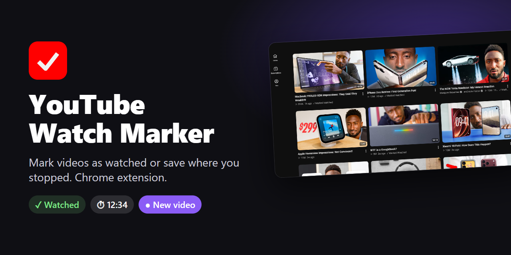

# YouTube Watch Marker: Track Watched Videos and Resume Timestamps



**YouTube Watch Marker** is a lightweight, privacy-friendly Chrome extension (Manifest V3) that shows which YouTube videos you've already watched. Mark a video as watched or save your timestamp from the player or toolbar popup, and see "Watched" / "Watched Till 12:34" badges on every channel's **Videos** tab. Clicking a timestamped video resumes right where you stopped. Everything stays in your browser.

Keywords: YouTube watched videos, YouTube watch history tracker, resume YouTube video, save YouTube timestamp, mark as watched, Chrome extension.

## Project Overview

YouTube doesn't tell you which of a channel's videos you've already seen, especially for long videos you stop halfway. This extension fills that gap. While watching, you click a small check icon in the player (or use the toolbar popup) to mark the video as watched or remember where you stopped. Back on the channel's Videos tab, each marked video shows a small "Watched" or "Watched Till 12:34" label, and clicking a timestamped one resumes from that time. When a video finishes, it is marked watched automatically and the menu pops up so you can undo that. On your subscriptions list (`/feed/channels`), each channel shows "New video" when its newest video has no mark, so you don't have to open every channel to check. Your saved timestamps also fill the main area of your watch history page (`/feed/history`), so you can pick up where you left off without opening the extension. Everything is stored locally in your browser, with nothing sent anywhere.

## Screenshots

| Channel Videos tab | Subscriptions feed |
| --- | --- |
|  |  |
| **In-player menu** | **Toolbar popup** |
|  |  |

**Saved timestamps on the watch history page**


## Features

- **Mark as Watched:** Flag any YouTube video as watched with a single click.
- **Save Timestamps:** Save your current playback position (e.g., `⏱ 12:34`) to resume or reference later.
- **Resume on Click:** Clicking a timestamped video on a channel's Videos tab opens it at the saved time, the same as the popup's saved list.
- **Channel /Videos Integration:** Displays `✓ Watched` or timestamp badges alongside video metadata on channel pages.
- **Import / Export:** Backup or transfer your saved history as a JSON file across browsers or devices.
- **In-Player Menu:** A check icon in the player's top-right opens a quick menu; it opens automatically when a video ends.
- **Green Check:** The player's check icon turns light green when the video is marked watched, so you can tell without opening the menu.
- **Auto-Mark on End:** A video that plays to the end is marked watched (replacing a saved timestamp). The menu stays open so you can clear it.
- **New-Video Badges:** On `/feed/channels`, each channel shows a purple `● New video` pill or a muted `✓ Up to date`, based on whether its latest video is marked. Results are cached for 24 hours.
- **Saved Timestamps on History:** `/feed/history` shows your saved timestamps as a grid of video cards (thumbnail, title, resume time); click one to resume, or use the trash icon to remove it.
- **Clean UI:** Contextual popup interface that dynamically updates based on whether you're viewing a video or browsing a channel.

## Installation

1. Clone or download this repository.
2. Open Chrome and navigate to `chrome://extensions/`.
3. Enable **Developer mode** using the toggle switch in the top right corner.
4. Click **Load unpacked** and select the extension root directory.

## File Structure

```text
YouTube Watch Marker/
├── assets/
│   ├── icon16.png
│   ├── icon48.png
│   ├── icon128.png
│   └── og-image.png
├── screenshots/
│   ├── Channel Videos.png
│   ├── Extension Popup.png
│   ├── Subscribtion Feed.png
│   └── Video Menu.png
├── popup/
│   ├── popup.html
│   ├── popup.css
│   └── popup.js
├── scripts/
│   ├── content.js
│   └── shared.js
├── .gitignore
├── LICENSE
├── manifest.json
└── README.md
```

## How It Works

- **Storage:** Marks are stored locally in Chrome's extension storage (`chrome.storage.local`) keyed by YouTube video IDs (`v:<videoId>`).
- **Content Script:** Detects video metadata rows on YouTube channel `/videos` tabs and injects matching badges using DOM mutations.
- **Popup Interface:** Reads the active tab state to offer contextual actions (Mark Watched, Save Timestamp, Clear, or Export/Import).

## License

Released under the [MIT License](LICENSE).
